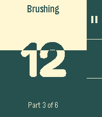
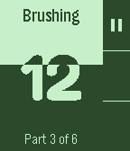
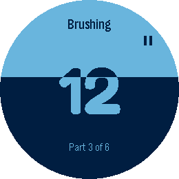

# Tútt Cepillado

Temporizador de cepillado dental para relojes Pebble. *A toothbrushing timer for Pebble watches* — [English below](#english).

<p align="center">
  
  
  
</p>

[Instálala desde la tienda de Pebble](https://apps.repebble.com/65ac389e4d2e43a9b4e87658).

## Cómo funciona

- **3 minutos en 6 tramos de 30 s** (o 15 s en modo rápido). Vibración doble al cambiar de tramo y tres pulsos al terminar.
- **Cuenta regresiva de 3 s** antes de empezar.
- **Cortina de progreso**: la pantalla se va descubriendo de arriba abajo; el número cambia de color justo donde la cortina lo cruza.
- **8 temas** con buen contraste (Clásico, Noche, Solarizado, Menta, Océano, Chicle, Atardecer y Limón), con vista previa en el menú. En los relojes en blanco y negro: Clásico y Noche.
- **Sigue aunque cierres la app**: guarda el avance y el reloj la vuelve a abrir en el siguiente cambio de tramo.
- En español e inglés, para todos los Pebble (aplite, basalt, chalk, diorite, emery, flint y gabbro), con pantalla táctil donde la hay.

| Botón | En reposo | Durante el cepillado |
|---|---|---|
| Select (o tocar la pantalla) | Elegir modo y empezar | — |
| Arriba / Abajo | — / menú de temas | Pausa y reanuda / — |
| Atrás | Salir | Dos veces: detener |

## Compilar

Con el [SDK de Pebble](https://developer.repebble.com/sdk/):

```sh
pebble build
pebble install --emulator emery
```

`herramientas/capturas.sh` genera las capturas de la tienda.

## Licencia

Código: [MIT](LICENSE). Tipografía [Fredoka](https://github.com/hafontia/Fredoka-One) (solo los dígitos): [SIL Open Font License 1.1](resources/fonts/OFL.txt).

---

<a id="english"></a>

# Tútt Cepillado (English)

A toothbrushing timer for Pebble watches. *Cepillado* is Spanish for "brushing".

[Get it from the Pebble appstore](https://apps.repebble.com/65ac389e4d2e43a9b4e87658).

- **3 minutes in 6 parts of 30 s** (or 15 s in quick mode). Double vibration on every part change and three pulses at the end.
- **3 s countdown** before starting.
- **Progress curtain**: the screen is uncovered from top to bottom; the number changes color right where the curtain crosses it.
- **8 themes** with good contrast (Classic, Night, Solarized, Mint, Ocean, Bubblegum, Sunset and Lemon), previewed in the menu. On black-and-white watches: Classic and Night.
- **Keeps going if you close the app**: progress is saved and the watch reopens the app at the next part change.
- English and Spanish, on every Pebble (aplite, basalt, chalk, diorite, emery, flint and gabbro), with touch where available.

| Button | Idle | While brushing |
|---|---|---|
| Select (or tap the screen) | Choose mode and start | — |
| Up / Down | — / theme menu | Pause and resume / — |
| Back | Leave | Twice: stop |

## License

Code: [MIT](LICENSE). [Fredoka](https://github.com/hafontia/Fredoka-One) typeface (digits only): [SIL Open Font License 1.1](resources/fonts/OFL.txt).
